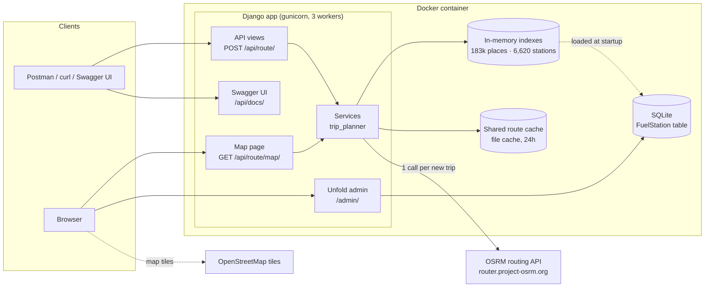
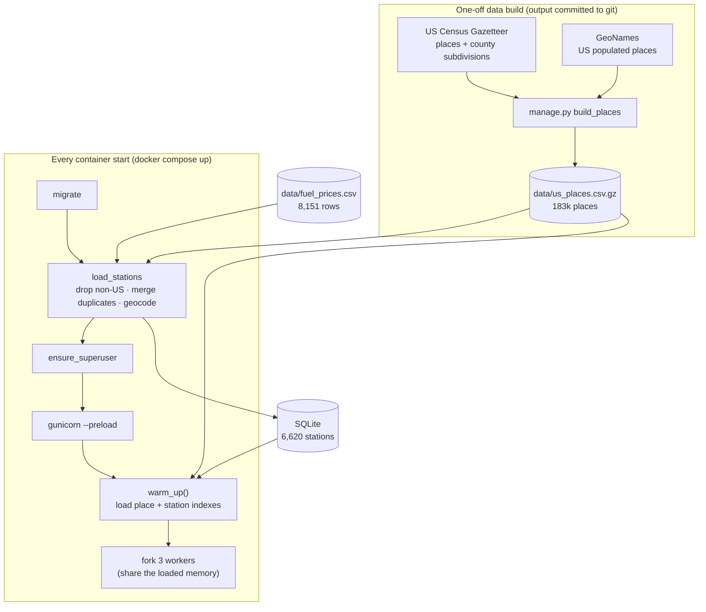
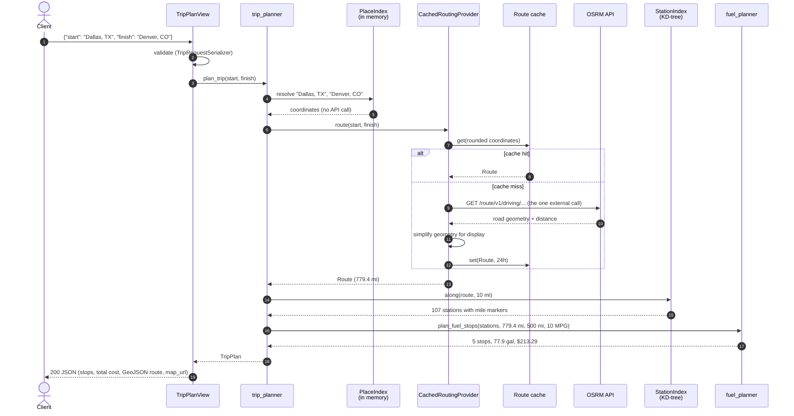
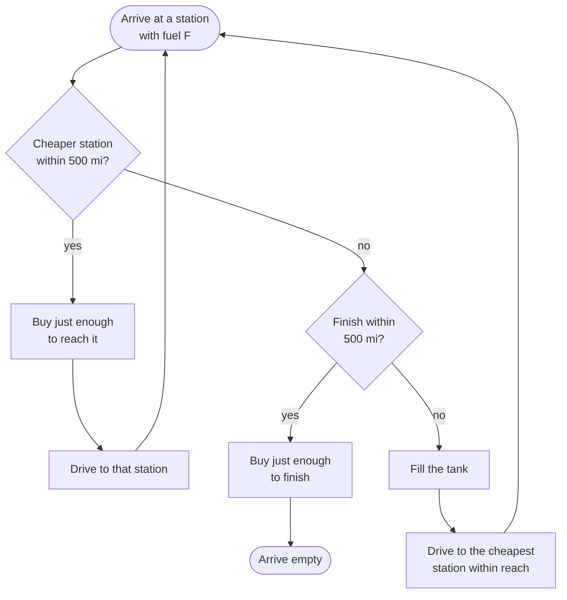
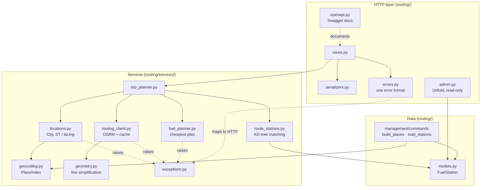
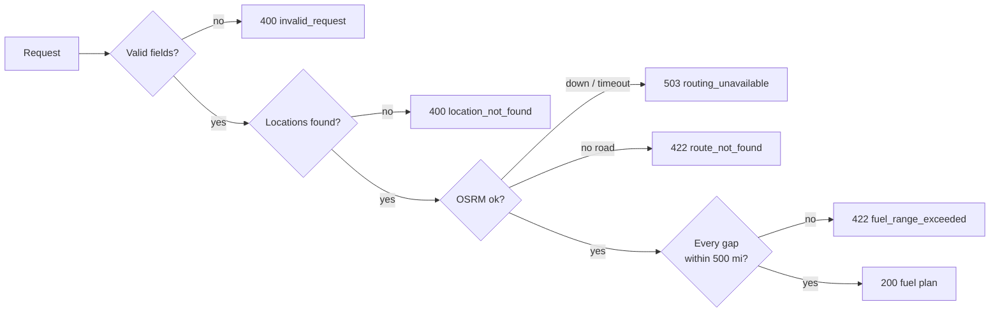

# Architecture

How the Fuel Route Optimizer is put together: the components, what happens at
startup, the path of a request, and where data lives. The diagrams are
[Mermaid](https://mermaid.js.org/) and render on GitHub.

## System overview

The only external call on the request path is **one OSRM route request per new
trip**. Everything else (geocoding, station matching, planning) runs on data
already in memory.

## Startup

The fuel price file has no coordinates, so stations are geocoded **once, before
the server accepts requests**, against a committed index of US places.

| Stage | Time | Result |
|---|---|---|
| `load_stations` | ~1s | 8,151 rows → 620 non-US dropped, 905 duplicates merged (lowest price kept), 6 not geocoded → **6,620 stations** |
| `warm_up()` | ~0.8s | Place index and station index in memory before the first request |

## Request flow: `POST /api/route/`

The map page (`GET /api/route/map/`) runs the same `plan_trip`. Its route is
already cached, so it makes no OSRM call.

| Step | Time (New York → Los Angeles) |
|---|---|
| Resolve locations | < 1 ms |
| OSRM route (new trip) | ~1–1.5 s |
| OSRM route (cached) | 0, read from cache |
| Stations along the route (459 found) | ~17 ms |
| Fuel plan | < 1 ms |
| **Total** | ~1.5 s new · **~10–100 ms** cached |

## Inside the fuel planner

At each candidate station the planner asks one question. This greedy rule is
provably optimal for a fixed route, and the tests check it against an exact
linear-programming solver.

Before planning, only the cheapest station in each 25-mile stretch is kept, so
plans avoid tiny stops. A stretch longer than 500 miles with no station returns
`422 fuel_range_exceeded`.

## Code structure

Views stay thin; all logic lives in plain-Python services, each testable on its own.

| Module | Responsibility |
|---|---|
| `trip_planner` | The single entry point: resolve → route → stations → plan |
| `locations` / `geocoding` | Turn `"City, ST"` or `"lat,lng"` into coordinates, offline |
| `routing_client` | One OSRM call, timeouts, error mapping, shared cache; swappable behind a `RoutingProvider` protocol |
| `route_stations` | Stations within 10 mi of the road, with mile markers |
| `fuel_planner` | Where to stop and how much to buy; exact `Decimal` money |
| `errors` | Every error, whether validation, planning or HTTP, as `{"error": {"code", "message"}}` |

## Where data lives

| Data | Stored in | Lifetime |
|---|---|---|
| Fuel prices (raw) | `data/fuel_prices.csv` (git) | Permanent: the source of truth |
| US place index | `data/us_places.csv.gz` (git) | Permanent; rebuilt with `build_places` |
| Geocoded stations | SQLite, `FuelStation` table | Rebuilt from the CSV on every start |
| Place + station indexes | Process memory, shared by workers | Until the server restarts |
| Routes from OSRM | Shared file cache (`CACHE_URL`) | 24 hours |
| Admin user | SQLite | Recreated on start from `DJANGO_SUPERUSER_*` |

## Errors

## Scaling beyond one container

| Today | Production | Change needed |
|---|---|---|
| Public OSRM server | Self-hosted OSRM | `OSRM_BASE_URL` |
| File cache, shared within one container | Redis, shared by all containers | `CACHE_URL=rediscache://…` |
| SQLite, rebuilt on start | Postgres | `DATABASE_URL`; `load_stations` already replaces the table atomically |
| City-level station positions | Address-level positions | Geocode station addresses once, offline |
